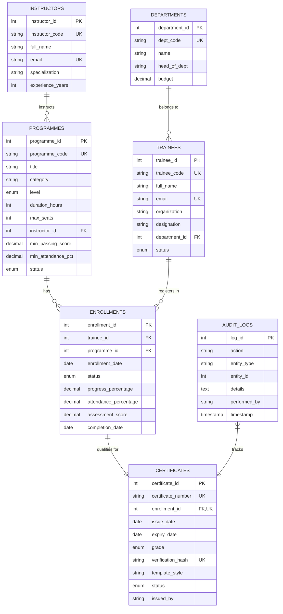

# 🎓 Training, Programme and Certificate Management System (TPCMS)

> **Enterprise Training, Learner Enrollment, and Cryptographically Verified Credential Issuance Platform**  
> *Developed for DBMS Course Projects & Enterprise Learning Operations.*

---

## 🌟 Executive Summary

**CertiTrack Pro (TPCMS)** is a full-stack, enterprise-grade web application and relational database management system designed to streamline corporate and academic training pipelines, monitor trainee progress and attendance, issue high-security verifiable credentials, and provide a public validation portal.

The application features a **Dual-Engine Architecture**:
1. **Production MySQL 8.0 Engine** (PyMySQL) with complete DDL schema, views, stored procedures, and triggers.
2. **Integrated Zero-Configuration Local Engine** (SQLite) that automatically boots out-of-the-box so evaluators can run and test all features instantly without requiring an external MySQL server running.
3. **In-App MySQL Connector & Query Console** enabling live credentials testing, schema migration, and arbitrary SQL query execution with immediate tabular feedback.

---

## 📐 Relational Database Schema & 1NF to 3NF Normalization

The database adheres strictly to relational database normalization principles (**1NF to 3NF**), ensuring data integrity, elimination of update/delete anomalies, and zero data redundancy.

### Entity Relationship Diagram (ERD)



---

### 🔬 Formal Normalization Proof (1NF ➔ 2NF ➔ 3NF)

| Normal Form | Rule | Implementation in TPCMS Schema |
| :--- | :--- | :--- |
| **1NF (First Normal Form)** | 1. Atomic scalar attributes (no multi-valued lists or arrays).<br>2. Unique rows identified by a Primary Key.<br>3. No repeating groups. | • Every table uses a dedicated Primary Key (`department_id`, `instructor_id`, `programme_id`, `trainee_id`, `enrollment_id`, `certificate_id`).<br>• Contact numbers, emails, grades, and dates are stored in single atomic columns.<br>• Syllabus modules and batch enrollments are decomposed into independent entities. |
| **2NF (Second Normal Form)** | 1. Satisfies 1NF.<br>2. No partial dependencies on composite keys (all non-key attributes fully dependent on candidate keys). | • All tables utilize single-attribute surrogate keys.<br>• In `enrollments`, the alternate key is `(trainee_id, programme_id)`. Non-key attributes (`progress_percentage`, `attendance_percentage`, `assessment_score`, `completion_date`) depend upon the *entire* enrollment combination, not just the trainee or the programme alone. |
| **3NF (Third Normal Form)** | 1. Satisfies 2NF.<br>2. No transitive dependencies ($X \to Y \to Z$). Every non-prime attribute depends directly on candidate keys. | • **Department Details**: Stored exclusively in `departments`; `trainees` stores only `department_id`.<br>• **Instructor Qualifications**: Stored exclusively in `instructors`; `programmes` stores only `instructor_id`.<br>• **Strict Certificate Normalization**: `certificates` references **only** `enrollment_id`. Redundant attributes (`trainee_id`, `programme_id`, and `score`) are **not duplicated** in `certificates` because $enrollment\_id \to (trainee\_id, programme\_id, score)$ is a transitive relationship. Trainee and course details are joined dynamically via database views (`vw_certificate_directory`). |

---

## ⚡ Advanced DBMS Features

1. **Relational Views**:
   - `vw_programme_analytics`: Real-time aggregated report of total enrollments, completion rates, average scores, and certificates issued per course.
   - `vw_certificate_directory`: Seamless 3NF joined view linking certificates, recipients, programmes, and instructors for instant reporting.
2. **Stored Procedures**:
   - `sp_issue_certificate`: Encapsulates eligibility verification (minimum score $\ge 75\%$, attendance $\ge 80\%$), grade determination, unique certificate code generation, SHA-256 cryptographic token hashing, enrollment status transition, and audit logging into an atomic transaction.
3. **Database Audit Logging**:
   - `audit_logs` records all critical administrative events, certificate issuances, and grade modifications.
4. **Foreign Key Integrity**:
   - Cascading updates/deletions on enrollments, restricted deletion on historical certificates to prevent credential tampering.

---

## 🚀 Quickstart & Installation

### 1. Prerequisites
- **Python 3.9+** installed (`python3 --version`).
- **MySQL 8.0+** (Optional: required only if connecting to live MySQL; SQLite fallback works automatically).

### 2. Setup Environment
```bash
# Clone or navigate to the repository
cd DBMS_Assignment_Book_Store_Management-

# Create virtual environment & install dependencies
python3 -m venv venv
./venv/bin/pip install -r requirements.txt
```

### 3. Launch Application
```bash
# Option A: One-click launcher script
./run.sh

# Option B: Direct Python execution
./venv/bin/python3 app.py
```

### 4. Access the Web Application
Open your browser and navigate to:
```
http://localhost:5050
```

---

## 🐬 Connecting to MySQL 8.0

To run against a local or cloud MySQL database (e.g. Homebrew MySQL, XAMPP, Docker, AWS RDS):

### Method A: Connect from the Web UI (Recommended)
1. In the top navigation bar, click **MySQL Settings** (or click the bottom-left **MySQL/SQLite Pill**).
2. Enter your MySQL server credentials:
   - **Host**: `localhost` (or IP)
   - **Port**: `3306`
   - **Username**: `root` (or your MySQL user)
   - **Password**: `your_password`
   - **Database**: `training_mgmt_db`
3. Click **Test Connection** to confirm connectivity.
4. Click **Connect & Migrate** — the system will automatically create the database, execute `database/schema.sql`, and switch the active engine to MySQL live!

### Method B: Environment Variables
You can also launch the app pre-configured with MySQL credentials:
```bash
export MYSQL_HOST="localhost"
export MYSQL_PORT="3306"
export MYSQL_USER="root"
export MYSQL_PASSWORD="your_password"
export MYSQL_DB="training_mgmt_db"

./run.sh
```

### Method C: Manual MySQL CLI Import
If you prefer importing the schema directly into MySQL via terminal:
```bash
mysql -u root -p < database/schema.sql
```

---

## 📖 Feature Walkthrough & User Manual

### 1. 📊 Executive Dashboard
- **KPI Metrics**: Displays live counters for Total Trainees, Active Training Programmes, Cryptographically Issued Certificates, and Overall Completion Rate.
- **Domain Focus Areas**: Visual progress bars showing course distribution across AI, Cloud, Cybersecurity, Software Engineering, and Management.
- **Recent Credentials**: Displays the latest certificates granted with one-click **View** buttons.
- **Security Audit Trail**: Live log of system actions with timestamps and operator IDs.

### 2. 🎓 Training Programmes Catalog
- **Filter & Search**: Filter courses by Category (AI, Cloud, Security, Management) and Status (*Open for Enrollment*, *In Progress*, *Completed*).
- **Seat Occupancy**: Real-time progress bar tracking registered learners against maximum capacity.
- **Create New Programme**: Click **Add New Programme** to define course title, category, level, instructor, duration hours, and passing grade benchmarks.

### 3. 👥 Trainees & Enrollment Management
- **Learners Roster**: Shows registered participants with contact details, company/college, attendance %, progress %, and assessment scores.
- **Register Trainee**: Register new participants with department affiliation.
- **Enroll in Course**: Enroll any registered learner into an active programme.
- **Grade & Record Progress**: Click **Grade & Progress** to dynamically update attendance %, completion %, exam marks, and instructor remarks.
- **Eligibility Checking**: If the trainee achieves $\ge \text{passing score}$ and $\ge \text{min attendance}$, the **Issue Cert** button becomes active!

### 4. 📜 Certificates Hub & High-Security Printable Document
- **Credential Registry**: Browse all issued certificates with grades (*Distinction*, *Honors*, *Pass*).
- **Issue Certificate**: Select an eligible graduate, choose a certificate aesthetic template, and click **Issue & Sign**.
- **Interactive Certificate Document**:
  - Click **View & Print** to open the certificate.
  - Features an **ornate double guilloche border**, **metallic embossed gold seal**, **curved academic typography**, **signature lines**, and a **SHA-256 integrity token**.
  - Click **Print / Save PDF** — formatted using `@media print` CSS to generate an authentic landscape A4 certificate ready for framing or digital download!
- **Shareable Verification Link**: Click **Copy Link** to share a direct verification URL.

### 5. 🔍 Public Credential Verification Portal
- Anyone (e.g. an employer or university recruiter) can navigate to `http://localhost:5050/#verify`.
- Enter any Certificate Number (e.g., `CERT-2026-89101`) or SHA-256 verification token.
- Instantly renders an official **"VERIFIED AUTHENTIC CREDENTIAL"** badge showing the recipient's name, course, score, honors, conferral date, and cryptographic signature hash.

### 6. 🗄️ Interactive MySQL & DBMS Console
- **Engine Status**: Shows whether you are currently connected to live MySQL or local fallback.
- **Entity Row Inspector**: Displays live row counts across all 7 database tables.
- **Interactive SQL Runner**: Type or click preset SQL statements (e.g., `SELECT * FROM vw_programme_analytics;`) and click **Execute SQL Statement** to see formatted result tables immediately in the browser!

---

## 🗂️ Project File Structure

```
├── app.py                     # Flask REST API & Web Server
├── run.sh                     # Automated startup script
├── requirements.txt           # Python library dependencies (Flask, PyMySQL, Cryptography)
├── README.md                  # Comprehensive Documentation & Normalization Guide
├── database/
│   ├── schema.sql             # Complete MySQL DDL, Views, Stored Procedures, & Seed Data
│   ├── db_manager.py          # Dual MySQL/SQLite database abstraction & query layer
│   └── tpcms_local.db         # Local SQLite fallback database (auto-generated)
└── static/
    ├── index.html             # Single-Page Application interface
    ├── css/
    │   └── styles.css         # Professional dark theme, glassmorphism, & printable certificate styles
    └── js/
        └── app.js             # Reactive UI logic, API calls, modals, & verification handlers
```

---

## 🛡️ License & Academic Notice

This project was developed for the **Database Management Systems (DBMS)** assignment on the topic **"Training, Programme and Certificate Management System"**. It implements production DBMS concepts including 1NF-3NF normalization, relational integrity, stored procedures, audit logging, and dual-engine adaptability.
